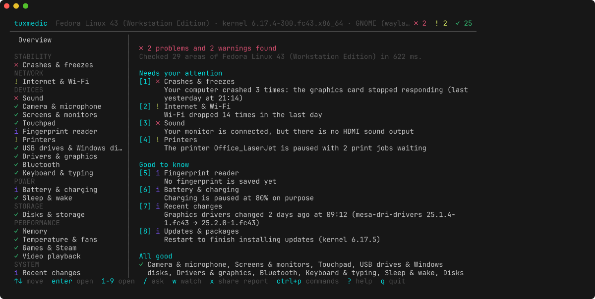
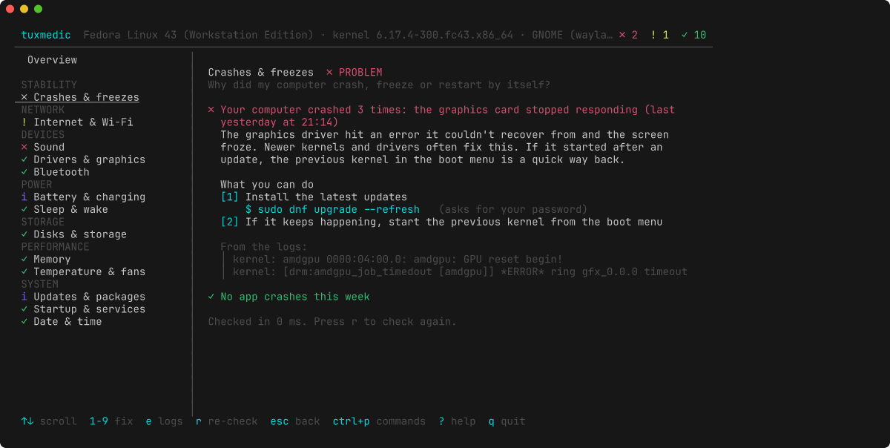

<div align="center">

# tuxmedic

Find out what's wrong with your Linux computer, and how to fix it.

[](https://github.com/rezk2ll/tuxmedic/actions/workflows/ci.yml)
[](https://github.com/rezk2ll/tuxmedic/releases/latest)
[](go.mod)
[](LICENSE)



</div>

The laptop froze last night, the Wi-Fi keeps dropping, the battery is stuck at 80%, there's no sound over HDMI. Linux logs the cause of most of these somewhere, but finding it means knowing which of a dozen tools to ask and how to read what they say.

tuxmedic asks them for you. It runs 30 checks, usually in under a second, and tells you what it found in plain words, with the exact command to fix it on your distro.

## What it checks

Each check answers a question people actually ask:

- Crashes & freezes: why did my computer crash, freeze or restart by itself? It reads the previous sessions' logs and names the cause: out of memory, graphics card hang, kernel panic, overheating. When the crashes began right after a kernel, graphics or desktop update, it says which one and how to go back.
- Internet & Wi-Fi: why can't I get online? It tells apart airplane mode, an adapter the network settings were told to ignore, a router with no internet, a router that never handed out an address (DHCP), broken DNS, hotel sign-in pages and a proxy that is set but doesn't answer, and notices a connection that keeps dropping, an IPv6 setup that makes every site stall, Wi-Fi stuck on the slow 2.4 GHz band next to a strong 5 GHz signal, Wi-Fi with no country set (which hides some 5 GHz networks), or a network cable that only links at 100 Mb/s.
- Sound: why is there no sound? Muted output, one app muted on its own while the others play, the wrong default device, a monitor with no HDMI profile, a Bluetooth headset stuck in call quality, missing firmware, PipeWire left with only "Dummy Output" because WirePlumber isn't running.
- Camera & microphone: why don't they work in video calls? Another app holding the camera, the GNOME privacy switches, a muted or silent microphone, a call app whose own input volume is muted, apps recording the speakers instead of the mic, Intel IPU laptop cameras that need extra drivers.
- Screen sharing & app sandbox: why is my shared screen black on Wayland? A missing or crashed desktop portal, no PipeWire, Flatpak apps with no Open and Save dialog, stuck snap updates and old snap versions eating disk space, snap apps that can't see USB drives, editors and sync apps out of file watches ("Unable to watch for file changes"), GNOME extensions that crashed or don't support the new GNOME yet, AppImages that won't open without libfuse2.
- Screens & monitors: why does my second monitor stay black? A monitor switched off in settings, a cable that doesn't pass the monitor's details, a DisplayLink dock without its driver, a Thunderbolt dock waiting for approval, a laptop screen whose brightness can't be changed (with the kernel setting that fixes it, for your boot loader), blurry X11 apps at fractional scaling on GNOME, a 144 Hz monitor left at 60 Hz, and a screen tinted yellow by Night Light.
- Keyboard & typing: why do keys type late or not at all? Slow Keys or Sticky Keys switched on by holding Shift, and input methods for other languages (IBus, Fcitx) that apps expect but aren't running, or that run twice, and Mac-layout keyboards (Keychron too) whose F1 to F12 change the volume unless you hold Fn.
- Touchpad: why doesn't it move the pointer? A touchpad Linux doesn't see at all, or one GNOME or KDE Plasma switched off (by a key, or while a mouse is plugged in), and tapping that doesn't click because tap to click is off.
- Fingerprint reader: why can't I log in with my finger? fprintd missing, a reader Linux has no driver for (with its USB ID to look up), no finger saved yet, or a saved finger that sudo never asks for.
- USB drives & Windows disks: why won't it open, or why is it read-only? A missing NTFS or exFAT driver, an NTFS drive Windows Fast Startup left marked as in use, a stick that is plugged in but not mounted, a Linux-formatted drive you can open but not save to, a phone that is plugged in but missing from the file manager.
- Printers: why can't I print? A stopped printing service, a printer CUPS paused after an error (and whether its driver is what failed), jobs stuck in the queue, a network printer that is ready but not added yet, a USB printer that needs ipp-usb to print without a driver.
- Battery & charging: why isn't it charging? A charge limit set on purpose, a charger too weak for the laptop, a worn battery, fast drain, performance mode left on after unplugging, two power-saving tools (TLP, auto-cpufreq, TuneD, the desktop's own) undoing each other.
- Disks & storage: is my disk full or failing? Free space and the cleanups that work on your distro, a disk switched to read-only, drive health (SMART) without root, an SSD that never gets TRIM, a desktop session log (`~/.xsession-errors`) grown to gigabytes.
- Drivers & graphics: is some hardware missing a driver? The graphics driver left switched off by the installer's "safe graphics" (nomodeset), NVIDIA with Secure Boot, Broadcom Wi-Fi, missing firmware.
- Video playback: why do videos stutter and the fans spin up? No VA-API driver for your Intel, AMD or NVIDIA graphics, so the processor decodes every frame, and the H.264 and HEVC codecs Fedora and openSUSE leave out.
- Games & Steam: why won't my games start? No Vulkan driver for Proton, the 32-bit driver Steam needs, Flatpak Steam without the controller rules, a game library on an NTFS, exFAT or FAT drive (where Proton can't run games), memory map and open file limits too low for big games and Proton's esync.
- Virtual machines & containers: why won't they start? Virtualization switched off in the firmware, virt-manager with no libvirt service running, libvirt's default network left stopped (so machines have no internet), VirtualBox refusing to run while KVM holds the processor (VERR_VMX_IN_VMX_ROOT_MODE), Docker installed but not started, Podman with no user ID range for your account.
- Notifications: why don't messages pop up? Do Not Disturb left on in GNOME or KDE Plasma, apps whose notifications were switched off one by one, or a window manager (Sway, Hyprland, i3) with no notification service, so every notification is dropped.
- Recent changes: it worked last week, what changed? Reads the update history (apt, pacman, rpm) and names the kernel, graphics, firmware, sound or desktop update most likely behind a new problem, with the way back.
- Also: sleep and wake (including an app holding off sleep during a download or backup, a lid that is set to do nothing, or to sleep even with a monitor plugged in, and hibernation blocked by Secure Boot or too little swap), memory and swap, temperatures and fans, a processor held far below its top speed by a setting or a weak charger, pending updates and stuck package managers, a connection marked as metered so updates never download by themselves, releases past their support (Ubuntu, Debian, Fedora and any distro that publishes an end date), apt sources that stopped downloading (old PPAs, expired keys), Arch systems left so long that the next update fails on signatures, Flathub missing or filtered so the software center shows few apps, slow startup and failed services (including startup waiting for a removed disk or hibernation swap), the clock (including a time zone left at UTC), languages that were never installed ("Setting locale failed"), emoji drawn as boxes, Word documents that reflow because Calibri or Arial has no same-width font, links, folders and PDFs whose default app was uninstalled, keyring password prompts caused by automatic login, Bluetooth (including chips whose firmware didn't load, adapters set to start switched off, and headphones that connect but play nothing because PipeWire's Bluetooth part is missing), groups that only work after you log out, Arduino and serial ports you have no permission for or that brltty takes over, an account locked for a few minutes after wrong passwords (so the right one is refused too), a renamed computer that slows down sudo ("unable to resolve host"), files in your home folder left owned by root, and SSH keys other users can read (which ssh then refuses).



## Install

Download the latest release and check it against the signed checksums:

```sh
curl -fsSL https://raw.githubusercontent.com/rezk2ll/tuxmedic/main/install.sh | sh
```

Or grab a package for your distro from the [releases page](https://github.com/rezk2ll/tuxmedic/releases/latest): `.deb`, `.rpm`, `.apk`, Arch `.pkg.tar.zst`, or a plain static binary for amd64, arm64 and riscv64.

With Go 1.26 or newer:

```sh
go install github.com/rezk2ll/tuxmedic/cmd/tuxmedic@latest
```

## Use

```sh
tuxmedic             # the interactive screen
tuxmedic ask "zoom can't hear me"   # only the checks your problem is about
tuxmedic watch       # record Wi-Fi drops and overheating while they happen
tuxmedic check       # print the results, for scripts and pipes
tuxmedic check sound battery
tuxmedic report      # a Markdown report to paste on a forum
tuxmedic check --json
```

In the interactive screen, press a number to open a check, then a number to run or copy one of its fixes. `n` jumps to the next check that found a problem, `e` shows the log lines a finding is based on, `/` lets you describe the problem in your own words and keeps the checks it is about, `w` watches for drops while you keep working, `ctrl+p` lists every command, and `?` shows all the keys. The mouse works too.

`tuxmedic watch` is for problems that come and go. Leave it running until the Wi-Fi drops again, then press Ctrl+C. It tells apart a weak signal, this computer dropping a good connection, and the router or provider losing the internet while the Wi-Fi stays up. `--for 30m` stops it on its own.

`tuxmedic check` exits with 1 when it finds a problem, so it works in scripts.

The packages and the install script add `man tuxmedic` and tab completion for bash, zsh and fish. With `go install`, add completion yourself, for example `tuxmedic completion bash > ~/.local/share/bash-completion/completions/tuxmedic`.

## Requirements

- Any Linux distro. CI installs and runs it on Ubuntu, Debian, Fedora, Arch, openSUSE, Alpine and Void. Checks that need systemd say so and step aside on systems without it. On image-based systems (Silverblue, Kinoite, Bazzite, Aeon, MicroOS) the fixes use rpm-ostree or transactional-update, and NixOS gets a pointer to the package instead of an install command.
- Any terminal, from 40×10 up. On the Linux console (`TERM=linux`) or with `--ascii`, it uses plain ASCII. When the output isn't a terminal, it prints plain text.
- No root. Run it as yourself. To see past crashes, your user needs to read the system log: many distros allow that already, otherwise tuxmedic tells you which group to join. `sudo tuxmedic` adds a few checks that need root, such as SMART on drives UDisks can't read.

## Privacy

tuxmedic only reads. It changes nothing unless you pick a fix and press Enter, and then it runs the command it showed you in your terminal. It sends nothing anywhere. The only network traffic is a connection test to 1.1.1.1 and 9.9.9.9 (and their IPv6 addresses, when your network has IPv6) and a DNS lookup of debian.org and kernel.org. When a proxy is set, it also opens a connection to the proxy to see if it answers, and sends nothing through it.

To tell you what changed since last time, tuxmedic keeps one small file, `~/.local/state/tuxmedic/last.json`, with the name and result of each check and nothing else. Delete it whenever you like.

`tuxmedic report` removes your host name, user name, home folder, MAC and IP addresses, emails, UUIDs and device serial numbers, so you can post it publicly. Read it before posting anyway.

## Build from source

```sh
git clone https://github.com/rezk2ll/tuxmedic
cd tuxmedic
go build ./cmd/tuxmedic
./tuxmedic
```

## How it works

Every check is a small function that reads `/proc`, `/sys`, the systemd journal, and tools such as `pactl`, `nmcli`, `busctl` and `systemctl` when they're installed. Checks read the machine through one interface, so the tests can replay a broken machine from fake files and command output. That's how the crash, battery, network and disk logic is tested without a broken laptop.

Checks run in parallel and the screen shows each result as it arrives. A check that hits something unexpected reports itself as skipped instead of taking the program down.

Why a terminal app and not a window: when the desktop is the thing that's broken, a terminal still works. It also works over SSH, in a text console, on any desktop, and on a friend's computer you're fixing for them.

## License

[GPL-3.0](LICENSE)

## Contributing

Found a problem tuxmedic missed, or a wrong diagnosis? [Open an issue](https://github.com/rezk2ll/tuxmedic/issues/new/choose) with the output of `tuxmedic report`. To add a check or fix one for your distro, see [CONTRIBUTING.md](CONTRIBUTING.md).
